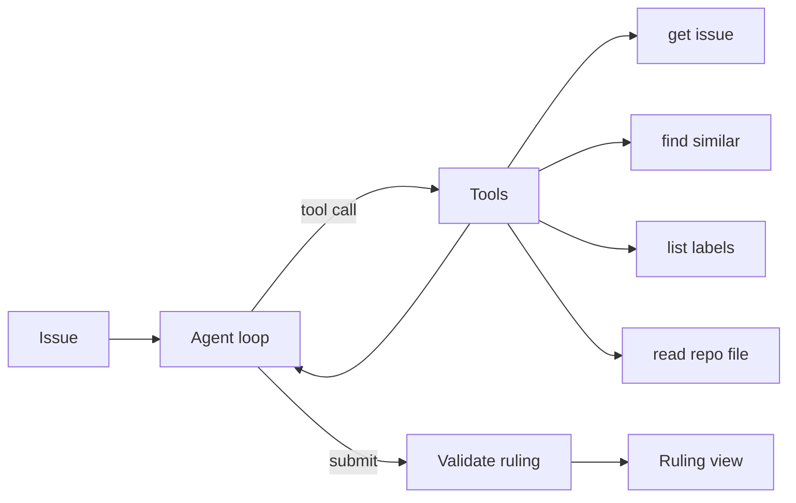
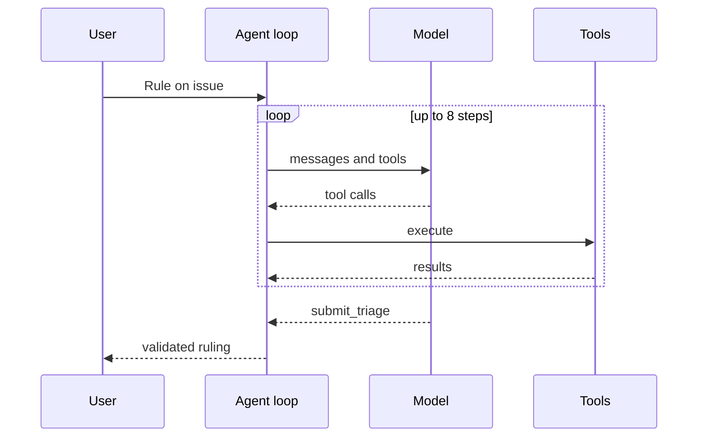

# Architecture

## Data flow

## Main sequence

## Modules

| Path | Responsibility |
|---|---|
| `lib/agent.ts` | Loop, prompts and provider adapters |
| `lib/tools.ts` | Tool definitions and executor |
| `lib/triage.ts` | Ruling schema and validation |
| `lib/similar.ts` | Duplicate ranking |
| `lib/github.ts` | Issue listing and file reads |
| `lib/analytics.ts`, `lib/analytics-sdk.ts` | Web analytics facade and its lazily imported vendor module |
| `lib/analytics-node.ts` | Bot analytics client, inert without a key |
| `components/` | Ledger, ruling and the pageview tracker |
| `instrumentation-client.ts` | Loads the analytics SDK on idle, only with a key |

## Principles

- Pure logic lives in `lib/` and is tested without a browser; components stay thin.
- Network, storage and model replies are validated at the boundary.
- Secrets and user content stay in the browser. Optional analytics reports counts, enumerations and the public repository name only, and is off without a key.

## Decisions

- [Terminal tool for structured output](adr/0001-terminal-tool-for-structured-output.md)
- [Read-only agent](adr/0002-read-only-agent.md)
- [Cookieless analytics that is off without a key](adr/0003-cookieless-analytics-off-without-a-key.md)
